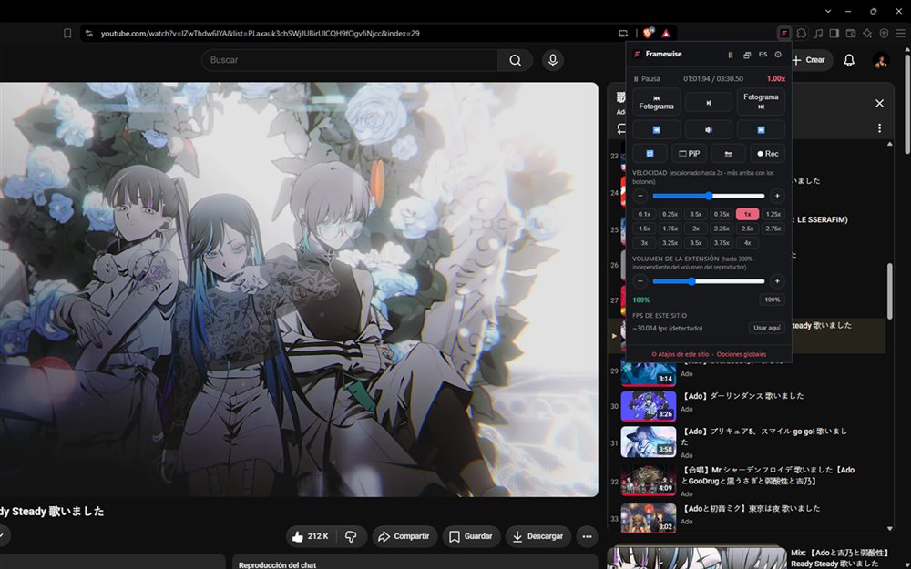
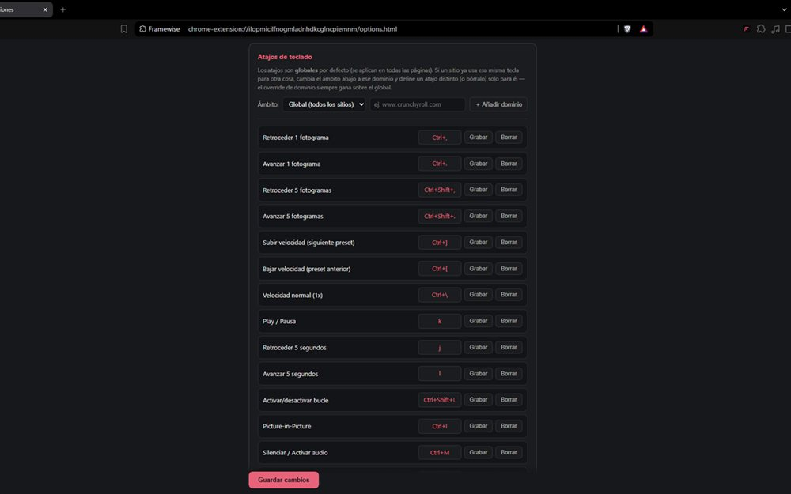
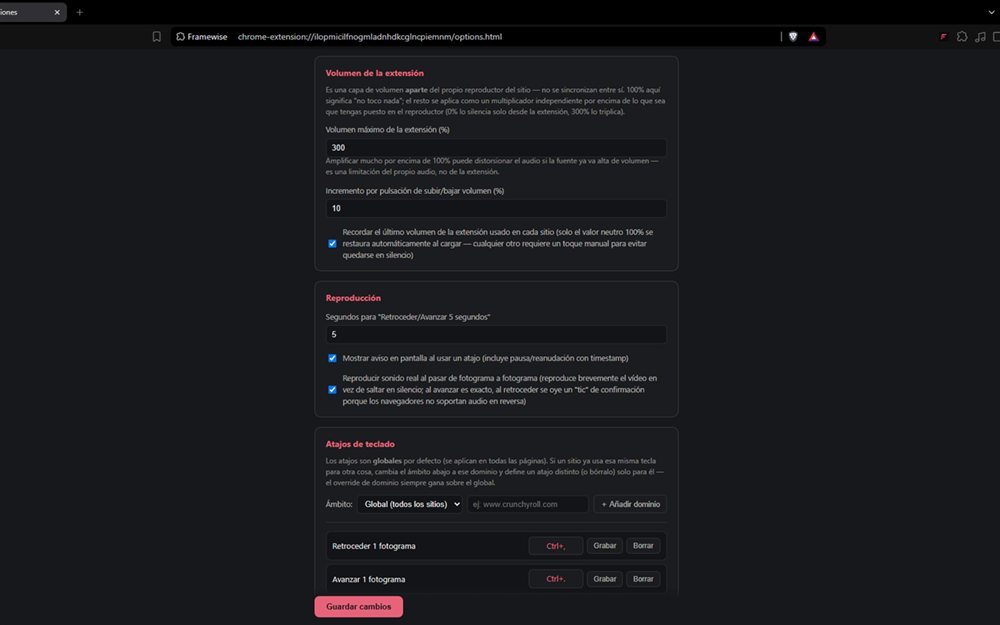

<p align="center">
  
</p>

<h1 align="center">Framewise</h1>

Framewise is a Manifest V3 browser extension (Chrome / Edge) for controlling any HTML5 `<video>` with frame-level precision: step forward/backward frame by frame, adjust playback speed, amplify volume beyond the browser's native limit, and define fully custom keyboard shortcuts — globally or per website.

**[framewise.zula.dev](https://framewise.zula.dev)** is the official product site — demos and screenshots live there. Framewise is published on the [Chrome Web Store](https://chromewebstore.google.com/detail/framewise/mkpljcojmhhmkpamcdecnmjbndbabfae) and [Microsoft Edge Add-ons](https://microsoftedge.microsoft.com/addons/detail/framewise/ppfmagbmfpeldadpbhbknlffhfnnhgee). This document covers installation, usage, configuration and the internals for anyone building or contributing to the extension.

## Screenshots

| Popup on YouTube | Shortcuts (Options) | Volume amplification (Options) |
| --- | --- | --- |
|  |  |  |

## Overview

Framewise started as a fix for one specific gap — Crunchyroll's player has no way to step through video frame by frame — and grew into a general-purpose toolkit for precise HTML5 video control that works on virtually any site (YouTube, Crunchyroll, Twitch, Vimeo, and any page using a standard `<video>` element).

It has no build step and no external dependencies: plain JavaScript, loaded directly via `content_scripts` and standard `<script>` tags.

## Languages

The interface (popup, Options page, on-screen overlay) is available in Spanish and English. By
default it follows the browser's own UI language (`chrome.i18n.getUILanguage()`, checked live —
English if it changes to it, Spanish for anything else) until you switch it by hand from the ES/EN
toggle in the popup header or the Options page; from then on it stays pinned to that choice, synced
across devices like any other setting. See `i18n.js` for the string dictionary and `ACTION_DEFS` in
`settings.js` for how action labels resolve through it.

## Features

### Seeking
- `j`/`l` (or the popup buttons) jump back/forward by the configured seconds and wait for each seek to really finish. Quick repeated presses are added up and applied as soon as the current seek completes (three quick `l` presses = three jumps), up to ten presses ahead; holding the key repeats at the seek's own pace and never keeps jumping after release. If a seek can't complete (unbuffered or DRM-protected segment), it reverts safely and any queued presses are dropped.

### Frame-by-frame navigation
- Step one frame forward or backward, with real audio on the forward step (the video is briefly played and paused exactly on the target frame via `requestVideoFrameCallback`, instead of silently jumping).
- Holding the forward key switches to real continuous playback instead of chaining discrete jumps, snapping back to the exact nearest frame on release.
- Configurable multi-frame jumps, with their own shortcut.
- Live FPS detection (`requestVideoFrameCallback`, median of recent frame intervals, re-armed every time playback starts and reset on every seek), with a manual override available globally or per domain. A per-domain FPS can be fixed from the popup ("Use here") and removed from the same button.
- Stall-safe seeking: if a jump requests a moment the site hasn't buffered (common with adaptive/DRM streaming), Framewise waits, and if it doesn't resolve, reverts to the last known-good position instead of leaving playback stuck.

### Playback speed
- Fully configurable speed presets (0.1×–4× by default, in 0.25 steps).
- Stepped popup slider — it can only land on a real preset, never an arbitrary in-between value — plus quick preset buttons for anything beyond the slider's range.
- `Ctrl` + mouse wheel over the video to move preset to preset (scrolling the page itself is left untouched without `Ctrl`).
- Remembers the last speed used per domain and re-applies it automatically — on page load and whenever the same `<video>` element loads a new source (the HTML standard resets `playbackRate` on every new source, which is what single-page sites like YouTube do between videos).
- Toolbar badge showing the active speed, including speeds applied automatically or changed from the site's own player.

### Volume amplification
- An **independent** volume layer, on top of whatever the site's own player volume is set to — the two are intentionally not linked. Framewise's volume never reads or writes the native `video.volume` property.
- 100% means "untouched"; anything else is a separate multiplier (0–300% by default, configurable) applied through a Web Audio `GainNode`, which is the only way to exceed the browser's native 0–100% ceiling.
- Per-domain memory, with one safety rule: the neutral 100% value is restored immediately on page load; any other value is restored only once the page has had a user interaction (`navigator.userActivation.hasBeenActive`) — right away if it already has one, otherwise on your first click or key press on the page. Building the audio graph before a user gesture can leave the browser's autoplay policy muting the tab entirely, so Framewise only connects it once the audio context is actually running; if the browser still refuses, the video keeps playing untouched.
- Not available on cross-origin video without CORS headers (a Web Audio API restriction, not something Framewise can bypass); the extension detects this and disables the control instead of failing silently.
- If the page hasn't received any click or key press yet, the browser keeps Web Audio suspended. Framewise then leaves the video untouched and asks for one interaction first, instead of routing its audio into a muted graph. One shared `AudioContext` per page serves every video.

### Keyboard shortcuts
- Every action has a default shortcut, fully reassignable from the Options page.
- Shortcuts never fire while typing: inputs, textareas, selects, `contenteditable` and text boxes inside (open) shadow DOM are ignored, as is any key press during IME composition.
- Recording a shortcut in Options warns (without blocking) when the combination is one the browser keeps for itself (`Ctrl+T`, `Ctrl+L`…) or uses `Ctrl+Alt` (AltGr, see below).
- Per-domain overrides: define a different shortcut (or disable one) for a specific site without touching the global default — useful when a site already uses the same key for something else. A domain override always wins over the global shortcut.
- Quick pause: a toolbar-popup button disables Framewise's own keyboard/wheel shortcuts on the current site only (in one click, no trip to Options) — for when one of them collides with a shortcut the site itself already uses. Popup buttons keep working normally while paused, since a deliberate click can't collide with anything.

### Reliable video detection
- Works even when the player lives inside an iframe, and when multiple videos are playing simultaneously across different frames — Framewise always targets whichever is actually playing (the largest one if several are, or the largest visible one if none are).
- Finds videos inside open shadow DOM (players built as Web Components). Closed shadow roots are unreachable by design; the manual picker covers them.
- Detects new videos automatically on single-page apps like YouTube, including when the player is replaced on playlist auto-advance without a full page reload.
- The service worker keeps its "which frame has the video" registry in `chrome.storage.session`, so it survives the worker being shut down after ~30 s of inactivity (before, the popup could stop finding a player inside an iframe after that).
- Self-healing content scripts: reloading or updating the extension can leave already-open tabs with an orphaned, disconnected copy of the script. The background service worker pings every open tab on startup and silently re-injects a fresh copy wherever needed, with a safe hand-off protocol so two copies never end up double-handling the same action.
- Three fallbacks when a video still isn't found: retry detection, reload the tab and retry, or manually pick the video by clicking directly on it (similar to a DevTools element picker) — the most reliable option regardless of the underlying cause. The picker resolves the exact `<video>` under the click point, even below a layer of player controls. While the popup is open and no video has been found yet, it keeps looking on its own.

### Other utilities
- Play/pause, mute, Picture-in-Picture.
- `<audio>` players (podcasts, radio, audiobooks) on pages with no `<video>` at all: play/pause, j/k/l, speed (and its per-site memory), the independent volume layer, loop and mute work the same; frame stepping, capture, clip and PiP are disabled in the popup with the reason. To avoid stealing keys from sites with their own j/k/l shortcuts, an `<audio>` only counts if it lasts more than 30 s (or is a live stream) and either shows its controls or is/was playing — short interface sounds are ignored. Whenever a page has a `<video>`, audio elements are ignored entirely.
- Loop, re-implemented manually (not via the native `loop` attribute, which can hang playback if the browser tries to seek back to a portion of the stream that's no longer buffered) — it uses the same stall-safe mechanism as frame stepping and reports a clear warning if it fails instead of breaking playback. Videos that the site itself loops (animated backgrounds, GIF-style clips) are left alone and shown as looping; toggling the loop off clears both.
- Frame capture to PNG (disabled automatically when the source video is DRM-protected and the browser blocks canvas access).
- Clip recording to WebM: click to start, click again to stop and download — records the video exactly as it's currently playing (same speed, same audio), via `HTMLMediaElement.captureStream()` + `MediaRecorder`. Disabled automatically for cross-origin video without CORS headers or DRM-protected content, for the same reason screenshots are. If the site swaps the video's source or removes the element while recording, the clip is closed and saved with what was recorded.
  - Configurable maximum length (10 minutes by default, 0 = no limit): when reached, the clip is stopped and saved automatically, since a recording is held in memory until it stops.
  - Crash-safe: while recording, each one-second chunk is also copied to the extension's own IndexedDB through the service worker. If the tab navigates away or is closed before you stop, Framewise opens a "Recovered clips" page (`recover.html`) in the background that downloads the clip and lets you download it again or delete it. Downloaded clips are cleaned up after a day, unclaimed ones after a week. No extra permission is involved.
- On-screen overlay confirming each action, including pause/resume with an exact timestamp — this also fires when pausing with the site's own native controls, not only through Framewise. It is drawn inside a closed shadow root (page CSS can't hide or distort it, page scripts can't read it) and shown in the browser's top layer, so it stays visible over any fullscreen element, including a `<video>` put in fullscreen by its native controls.
- Detachable popup window that stays open regardless of where you click, and an optional true always-on-top floating mode (Document Picture-in-Picture, Chrome/Edge 116+).
- Configuration export/import as JSON, and a "reset everything" action with a two-step confirmation. Imported files are validated value by value (ranges, hostnames, known actions); per-domain pauses are part of the backup.

## Installation

### Chrome Web Store / Microsoft Edge Add-ons
- Chrome: [chromewebstore.google.com/detail/framewise/mkpljcojmhhmkpamcdecnmjbndbabfae](https://chromewebstore.google.com/detail/framewise/mkpljcojmhhmkpamcdecnmjbndbabfae)
- Edge: [microsoftedge.microsoft.com/addons/detail/framewise/ppfmagbmfpeldadpbhbknlffhfnnhgee](https://microsoftedge.microsoft.com/addons/detail/framewise/ppfmagbmfpeldadpbhbknlffhfnnhgee)

### Developer mode
1. Clone this repository.
2. Open `chrome://extensions`.
3. Enable **Developer mode**.
4. Click **Load unpacked** and select the project folder.

## Usage

Open any page with a video playing and use the default shortcuts:

| Action | Default shortcut |
| --- | --- |
| Previous frame | `Ctrl+,` |
| Next frame | `Ctrl+.` |
| Previous N frames | `Ctrl+Shift+,` |
| Next N frames | `Ctrl+Shift+.` |
| Increase speed (next preset) | `Ctrl+]` |
| Decrease speed (previous preset) | `Ctrl+[` |
| Reset speed to 1× | `Ctrl+\` |
| Play / Pause | `k` |
| Seek backward | `j` |
| Seek forward | `l` |
| Loop | `Ctrl+Shift+L` |
| Picture-in-Picture | `Ctrl+I` |
| Mute | `Ctrl+M` |
| Screenshot | `Ctrl+Shift+F` |
| Record clip | `Ctrl+Shift+G` |
| Volume up | `Ctrl+Shift+↑` |
| Volume down | `Ctrl+Shift+↓` |
| Volume reset (100%) | `Ctrl+Shift+\` |

Transport controls (`Play/Pause`, `Seek backward`, `Seek forward` — `k`/`j`/`l`) are a deliberate
block that stays bare, mirroring YouTube's own native j/k/l shortcuts, and are the only exception:
`Ctrl+K`, `Ctrl+J` and `Ctrl+L` are reserved by Chrome/Edge itself (omnibox search, Downloads page,
and address-bar focus respectively) and never reach the page at all, so adding `Ctrl` there would
have silently broken the extension's three most-used actions.

Every other action always takes a modifier — `Mute` included, even though it could plausibly mirror
YouTube's own bare `m`, to keep the rule simple: **bare keys belong only to that one named transport
block; everything else Framewise-specific is always modified.** Two details worth knowing if you
reassign these yourself:
- `Volume up`/`down` use `Ctrl+Shift+↑`/`Ctrl+Shift+↓`, not plain `Ctrl+↑`/`Ctrl+↓` — on macOS,
  unmodified `Ctrl+↑`/`Ctrl+↓` are the default Mission Control shortcuts at the OS level, intercepted
  before Chrome ever sees them.
- `Record clip`/`Screenshot` avoid any `Ctrl+Alt+*` combination — on many European keyboard layouts,
  typing a character with AltGr is reported to the browser as `Ctrl+Alt` held together, indistinguishable
  from a real one.

How keys are matched:
- Letters are case-insensitive (`k` and `K` are the same key; `Shift+K` is a different shortcut).
- When `Shift` changes the character of a punctuation key (`Ctrl+Shift+,` arrives as `<` on a US
  layout and as `;` on a Spanish one), Framewise also matches the key by its physical position, so the
  defaults `Ctrl+Shift+,`, `Ctrl+Shift+.` and `Ctrl+Shift+\` work on any layout. This fallback never
  applies to letters, digits or unshifted keys, so other layouts (AZERTY, Dvorak…) are not reinterpreted.
- On layouts where `[`, `]` or `\` need AltGr (Spanish, German, French…), the default speed shortcuts
  `Ctrl+[`, `Ctrl+]`, `Ctrl+\` and the volume reset `Ctrl+Shift+\` can't be typed. Options offers a
  one-click switch to `Ctrl+Shift+←` / `Ctrl+Shift+→` (speed), `Ctrl+Shift+Enter` (speed 1x) and
  `Ctrl+Shift+Backspace` (volume 100%), highlighted when the browser reports such a keyboard layout. It only
  touches actions you haven't customized, skips any combination another action already uses, and stays
  an unsaved change until you press Save. The factory defaults themselves don't change.

Click the toolbar icon for the quick popup (frame stepping, speed, volume, play/pause, capture, etc.), or the gear icon (or "Shortcuts for this site" from the popup) to open the full Options page.

## Configuration

Everything is adjustable from the Options page:
- Keyboard shortcuts, globally or per domain, with clash detection when recording a new one.
- Speed presets (add/remove individually, or step in 0.25 increments anchored at 0), default speed increment, and whether speed is remembered per domain.
- Volume maximum, step size, and whether it's remembered per domain.
- FPS: global default, or fixed per domain (overrides live detection).
- Seek length in seconds, multi-frame jump size, on-screen overlay toggle, frame-step audio toggle, maximum clip length.
- Export the full configuration as JSON, import it back, or reset everything to defaults (double confirmation required).

Changes on the Options page are applied with **Save changes**; an "Unsaved changes" marker shows when
there is something pending. Changes made elsewhere meanwhile (the popup, a video tab remembering its
speed) are merged in without discarding what you're editing, and the browser asks for confirmation
if you close or reload the page with changes still unsaved.

## Architecture

Manifest V3, no bundler, no runtime dependencies.

| File | Role |
| --- | --- |
| `manifest.json` | Extension manifest |
| `i18n.js` | es/en string dictionary and translation helpers (`T`, `applyI18n`) — loaded before everything else |
| `settings.js` | Default settings and shared utilities (loaded by content, popup and options scripts) |
| `content.js` | Core logic — runs once per frame of every page: video control, shortcuts, overlay, FPS/capability detection |
| `background.js` | Service worker — toolbar badge, cross-frame video resolution, orphaned content-script recovery |
| `popup.html/js/css` | Toolbar popup |
| `options.html/js/css` | Options page |
| `overlay.css` | On-screen confirmation overlay and manual video-picker banner |
| `recover.html/js/css` | "Recovered clips" page, opened when a tab navigated or closed while recording |
| `icons/` | Toolbar icons (16/48/128px) |

**Core components:**
- **Background service worker.** Tracks, per tab, which frame(s) currently hold a video (needed because the player can live inside an iframe, or several can play at once across frames); resolves which one is "active" the same way a single frame would (playing > largest visible). Also keeps the crash-safe copy of a clip being recorded (chunks streamed over a port into IndexedDB) and opens the recovery page if the recording tab goes away. Also owns the self-healing mechanism: on startup it pings every open tab, and re-injects `content.js` via `chrome.scripting` wherever no live script responds.
- **Content script.** One instance per frame. Each instance announces itself on load and any previous instance in the same document tears itself down cleanly (listeners removed, observers disconnected) — this is what makes re-injection safe without risking two copies acting on the same keypress. It owns frame stepping, speed, the independent volume layer, the manual loop implementation, capability detection, and the manual video picker.
- **Popup / Options pages.** Communicate with the content script via `chrome.runtime` messaging, resolving the correct target frame through the background worker, with automatic retries to cover the brief window right after a page loads.

**Storage.** Settings are split across two storage areas on purpose (plus `chrome.storage.session`, used only by the service worker for its frame registry — in memory, cleared when the browser closes): `chrome.storage.sync` holds shortcuts, presets, per-domain shortcut overrides and per-domain shortcut pauses — all deliberate choices worth carrying across the user's devices — while `chrome.storage.local` holds per-domain remembered speed/volume/FPS (these grow with every site visited and would otherwise risk hitting `sync`'s much smaller quota).

**Action metadata vs. user preference.** `ACTION_DEFS` in `settings.js` (label, whether it repeats on hold, factory shortcut) is a plain in-code constant, never read from or written to storage — only the actual chosen shortcut (`settings.shortcuts`, keyed by action id) is persisted, and only for actions that differ from `ACTION_DEFS`'s current default. This means a label or a new default shortcut shipped in a future version reaches every existing user immediately, without needing another migration: nothing about the display text or the factory value is ever frozen into what a past version happened to save. Versions before this split stored a full `{label, shortcut, repeatable}` blob per action in `chrome.storage.sync.actions`; `loadSettings()` migrates it automatically and once, keeping only shortcuts that genuinely differ from every default that action has ever had (old or current) — see `migrateLegacyActions` in `settings.js`.

## Known Limitations

- **Seeking beyond what the site has buffered isn't always possible.** With DRM-protected streaming (Widevine, etc.), the `<video>` element can't fetch content on its own — only the site's own JavaScript decides what to load and when. Framewise detects this and reverts safely instead of hanging, but it cannot force a site to load a segment it doesn't want to serve.
- Audio on the backward frame step is an approximate confirmation tick, not true reverse playback (browsers don't support real reverse audio).
- PNG frame capture can fail on DRM-protected video, since the browser blocks reading `<canvas>` content from protected sources.
- Clip recording is only available as WebM (Chrome's `MediaRecorder` doesn't natively mux MP4), and fails for the same cross-origin/DRM reasons as PNG frame capture.
- Volume amplification above 100% may be unavailable on cross-origin video without CORS headers.
- The floating window mode requires Chrome/Edge 116+ (Document Picture-in-Picture API); the button simply doesn't appear on unsupported browsers.
- Automatic video detection, despite the safeguards above, can still occasionally miss on specific sites or edge cases that haven't been fully characterized yet (closed shadow roots, for example). The manual video picker is the reliable fallback — it works regardless of the underlying cause.
- A recovered clip (tab navigated or closed while recording) can miss its last second, and, like any WebM written by `MediaRecorder`, may not be seekable in every player. If the browser itself is closed while recording, the clip is offered the next time it starts.
- `<audio>` elements inside shadow DOM, or audio-only players that haven't started playing and show no controls, aren't detected automatically.

## Development

The extension itself has no build step and no dependencies. Development-only tooling lives in
`tests/` and is never part of the published package.

```sh
cd tests
npm install                     # Playwright (dev only)
npx playwright install chromium # once, if you don't already have Playwright's Chromium
npm test                        # all automated tests (~1 min)
npm run pack                    # dist/framewise-<version>.zip, ready for the stores
```

- **Tests** (`tests/specs/`, Node's built-in test runner + Playwright) load the unpacked extension in
  Chromium (`--load-extension`) and drive local test pages (`tests/fixtures/`) with generated sample
  videos (ffmpeg test patterns, no third-party content). They cover shortcuts (including not firing
  while typing), frame stepping and FPS detection, speed and its per-domain memory, volume and the
  autoplay policy, iframes, several videos, shadow DOM, screenshot, clip recording, loop, the manual
  picker, the overlay, the service worker registry, popup, Options, export/import (including hostile
  files) and settings migrations from 1.0.0 and the older `actions` format. Set `HEADED=1` to watch.
- **Packaging** (`tests/pack.js`) zips an explicit allowlist of extension files only; a test loads the
  resulting ZIP to make sure it works on its own.
- Things that can't be automated here (real DRM streams, specific sites such as YouTube or
  Crunchyroll, Edge itself, macOS) are covered by the manual checklist in `tests/MANUAL-CHECKLIST.md`.

## Contributing

Bug reports, feature requests and pull requests are welcome — open an issue to discuss anything non-trivial before submitting a PR.

## License

MIT — see [LICENSE](LICENSE).
